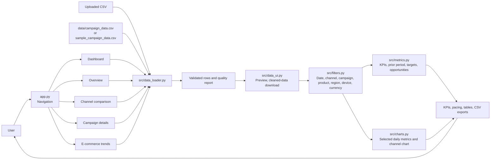
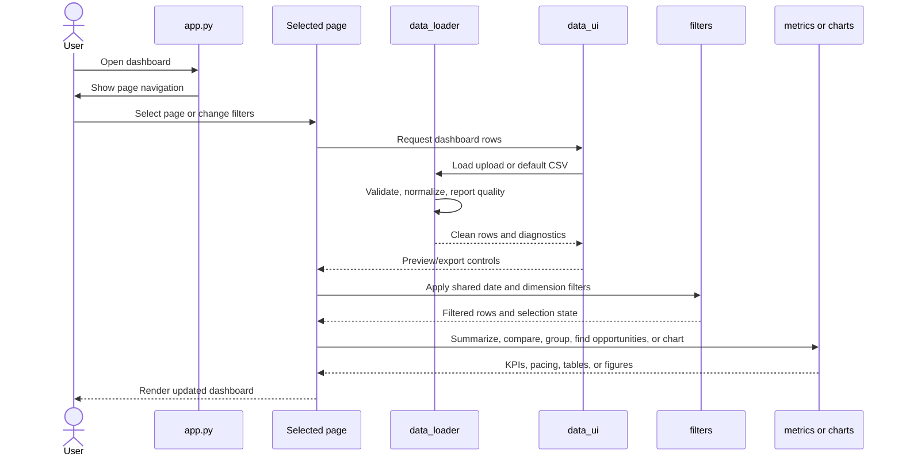
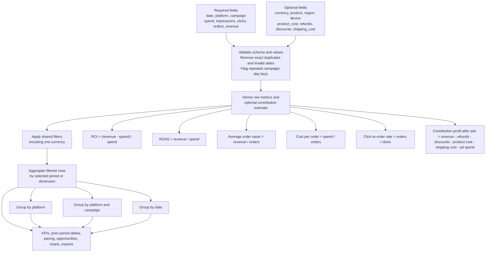

# E-commerce ROI Dashboard

A multipage Streamlit dashboard for exploring paid marketing performance against ecommerce sales.

## Project structure

```text
.
├── app.py                         # Streamlit navigation entry point
├── pages/                         # Streamlit multipage views
├── src/                           # Shared loading, filters, metrics, and charts
├── tests/                          # Automated checks for core metrics and charts
├── prompts/                       # Reusable project and task prompts
│   ├── system_prompt.md
│   ├── feature_request.md
│   ├── bug_fix.md
│   └── code_review.md
├── data/                          # Location for your working campaign CSV
├── sample_campaign_data.csv       # Starter ecommerce dataset
├── requirements.txt
├── AGENTS.md                      # Repository instructions for coding agents
├── SKILL.md                       # Project workflow and data conventions
├── PRODUCT_SPEC.md                # Behaviors and acceptance criteria
└── README.md
```

## Run locally

```bash
python -m venv .venv
source .venv/bin/activate        # Windows: .venv\Scripts\activate
pip install -r requirements.txt
streamlit run app.py
```

The app uses `data/campaign_data.csv` when present and otherwise loads `sample_campaign_data.csv`. You can also upload a CSV from the sidebar. Expected columns are `date`, `platform`, `campaign`, `spend`, `impressions`, `clicks`, `orders`, and `revenue`. The loader also accepts the earlier `conversions` column as an alias for `orders`. Optional columns include `currency`, `product`, `region`, `device`, `product_cost`, `refunds`, `discounts`, and `shipping_cost`. Missing currency is assumed to be USD and called out in the data quality panel.

Metrics include orders, click-to-order rate, average order value, cost per order, ROAS (`revenue / ad spend`), and ROI (`(revenue - ad spend) / ad spend`). Revenue and spend must use the same currency. Zero-spend ratios are shown as unavailable. The sample is illustrative and does not represent actual store performance.

## Dashboard capabilities

- Shared date, platform, campaign, product, region, device, and single-currency filters.
- Equal-length previous-period comparisons for spend, revenue, orders, ROAS, and ROI.
- Session-level spend budget, revenue goal, ROAS target, and campaign opportunity threshold controls.
- Campaign flags for high-spend campaigns below target ROAS and low-spend campaigns meeting target ROAS.
- CSV quality feedback for removed exact duplicates, invalid dates, numeric values defaulted to zero, and repeated date/platform/campaign keys. Preview and download normalized data.
- Downloads for filtered rows, channel summaries, business breakdowns, and campaign opportunities.
- Estimated contribution profit after ads when product cost and shipping cost are supplied: `revenue - refunds - discounts - product_cost - shipping_cost - ad spend`. This prototype excludes taxes.
- Tests for sample KPI totals, zero denominators, weighted group metrics, legacy schema support, period comparisons, and selected chart metrics. Run with `python -m unittest discover -s tests`.

## Architecture

Streamlit handles navigation and page rendering. All pages use the same upload, validation, preview, export, and filter helpers. Metric and chart helpers aggregate the filtered rows for dashboard summaries, period comparisons, targets, opportunities, breakdowns, and trends.



## Page request flow

Each page loads the selected source through the shared data UI helper, shows quality feedback and a preview/download option, applies synchronized sidebar filters, and renders its view. The dashboard also compares the selected window with the previous equal-length window and evaluates configured targets.



## Data and metric flow



## Module responsibilities

- `app.py` defines Streamlit navigation and the default page.
- `src/data_loader.py` loads uploaded or local CSV data, validates fields, normalizes types, and derives row-level metrics.
- `src/data_ui.py` provides shared upload, quality feedback, preview, and cleaned-data download controls.
- `src/filters.py` applies date, platform, campaign, product, region, device, and currency selections.
- `src/metrics.py` calculates totals, weighted ratios, previous-period comparisons, targets, campaign opportunities, and grouped breakdowns.
- `src/charts.py` creates selected-metric daily trends and channel comparisons.
- `pages/` contains the dashboard, overview, channel comparison, campaign details, and trend views.
- `tests/` contains `unittest` checks for baseline metrics, zero denominators, grouping, filters, schema compatibility, prior-period comparisons, and chart selections.

The data loader accepts the older `conversions` column as an alias for `orders`. Zero denominators produce unavailable ratios. Contribution profit is only available when product-cost and shipping-cost values are complete for the selected rows. Exact duplicate rows are removed; rows with repeated date/platform/campaign keys but different values are flagged for review and retained.

## Prompt files

Use [`prompts/system_prompt.md`](prompts/system_prompt.md) as the project-specific system guidance for a coding assistant. Pair it with [`SKILL.md`](SKILL.md) for repository conventions, then use the task template that matches your work:

- [`prompts/feature_request.md`](prompts/feature_request.md) for implementing a feature.
- [`prompts/bug_fix.md`](prompts/bug_fix.md) for investigating and fixing an issue.
- [`prompts/code_review.md`](prompts/code_review.md) for reviewing proposed changes.

Paste the system prompt into the assistant's project instructions or system-prompt field when supported. Otherwise, include it and the relevant task template in your request.

## Agent guidance and product behavior

[`AGENTS.md`](AGENTS.md) contains repository instructions for coding agents. [`PRODUCT_SPEC.md`](PRODUCT_SPEC.md) documents the intended behavior, data contract, acceptance criteria, sample-data reference totals, and unresolved business decisions. Keep these files current when product behavior changes.

For an end-user guide to the dashboard, filters, metrics, CSV format, targets, exports, and limitations, see [`PRODUCT_DOCUMENTATION.md`](PRODUCT_DOCUMENTATION.md).
