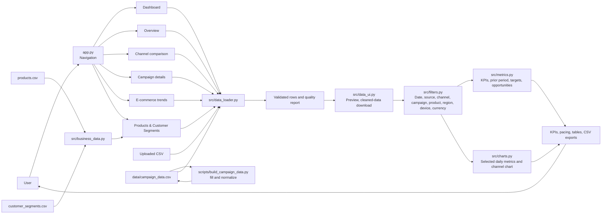
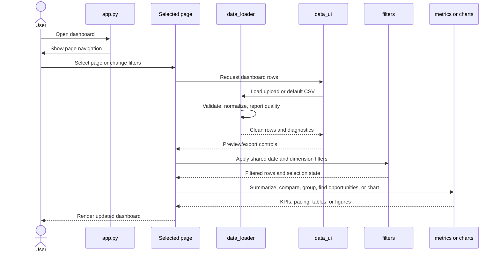
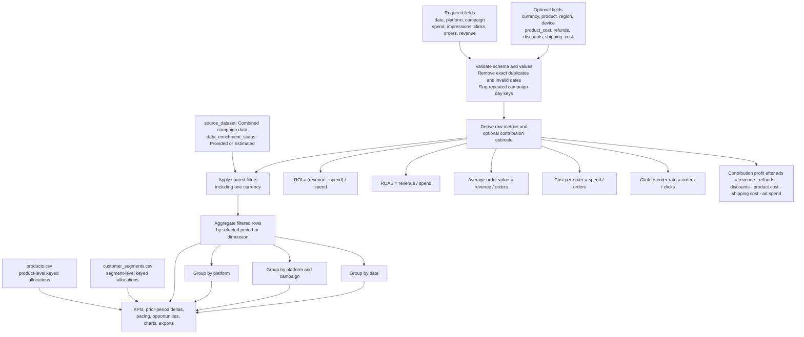

# E-commerce ROI Dashboard

A multipage Streamlit dashboard for exploring paid marketing performance against ecommerce sales.

## Project structure

```text
.
├── app.py                         # Streamlit navigation entry point
├── pages/                         # Streamlit multipage views
├── src/                           # Shared loading, filters, metrics, and charts
├── tests/                          # Automated checks for core metrics and charts
├── prompts/                       # Reusable project and task prompts
│   ├── system_prompt.md
│   ├── feature_request.md
│   ├── bug_fix.md
│   └── code_review.md
├── data/                          # Project data
│   ├── campaign_data.csv          # Combined, normalized campaign dataset
│   ├── products.csv               # Keyed product allocations
│   └── customer_segments.csv      # Keyed customer-segment allocations
├── scripts/build_campaign_data.py # Normalize combined campaign data
├── scripts/add_business_summary_keys.py # Key aggregate business summaries
├── requirements.txt
├── AGENTS.md                      # Repository instructions for coding agents
├── SKILL.md                       # Project workflow and data conventions
├── PRODUCT_SPEC.md                # Behaviors and acceptance criteria
└── README.md
```

## Run locally

```bash
python -m venv .venv
source .venv/bin/activate        # Windows: .venv\Scripts\activate
pip install -r requirements.txt
streamlit run app.py
```

Normalize the campaign data file after editing it:

```bash
python scripts/build_campaign_data.py
python scripts/add_business_summary_keys.py
```

The app uses an uploaded campaign CSV first, then the canonical `data/campaign_data.csv`. The combined file uses `Combined campaign data` as its source label. Missing region and device values are assigned valid existing categories. Missing product costs are estimated from the median product-cost-to-revenue rate in rows with supplied costs; shipping costs use the median shipping cost per order. Estimated rows are labeled `Estimated` in `data_enrichment_status`. The builder normalizes and enriches the canonical file in place. The loader also accepts `channel`, `ad_spend_usd`, and `revenue_usd` input aliases, and the legacy `conversions` alias for `orders`.

The `data/products.csv` and `data/customer_segments.csv` files power the Products & Customer Segments page. They include date, channel, and campaign keys, including modeled August 2026 allocations. Run `python scripts/add_business_summary_keys.py` to distribute their aggregate totals across the matching campaign rows. This allows date, platform, campaign, and month filtering while preserving the full totals; individual key-level and monthly values are synthetic allocations. Source ROI values are retained where the source does not define their formula.

Metrics include orders, click-to-order rate, average order value, cost per order, ROAS (`revenue / ad spend`), and ROI (`(revenue - ad spend) / ad spend`). Revenue and spend must use the same currency. Zero-spend ratios are shown as unavailable. The sample is illustrative and does not represent actual store performance.

## Dashboard capabilities

Product and customer-segment values are distributed across keyed campaign-grain rows for filtering and are not presented as directly observed attribution.

- Branded Dashboard with a dark title banner, light neutral canvas, six KPI cards with prior-period changes, a weekly revenue/profit chart, data-derived insights, channel performance, and an ad-click-to-order summary.
- The Dashboard's `Metric Month` multi-select scopes its metrics within the shared date range. Other pages continue to use the shared sidebar filters.
- Products & Customer Segments has its own `Metric Month` multi-select, defaulting to all months available after shared filters; the selection scopes both summary tables, their displayed metrics, and downloads.
- Campaign metrics use the canonical combined campaign dataset; product and customer summaries come from their separate aggregate CSVs.
- Shared date, data source, platform, campaign, product, region, device, and single-currency filters.
- Equal-length previous-period comparisons for spend, revenue, orders, ROAS, and ROI.
- Session-level spend budget, revenue goal, ROAS target, and campaign opportunity threshold controls.
- Campaign flags for high-spend campaigns below target ROAS and low-spend campaigns meeting target ROAS.
- CSV quality feedback for removed exact duplicates, invalid dates, numeric values defaulted to zero, and repeated date/platform/campaign keys. The sidebar's cleaned-data preview browses the full normalized file in a scrollable table and shows its row count and date range; the cleaned CSV can be downloaded there too.
- Downloads for filtered rows, channel summaries, business breakdowns, and campaign opportunities.
- Estimated contribution profit after ads: `revenue - refunds - discounts - product_cost - shipping_cost - ad spend`. Rows with imputed costs are marked `Estimated`; this prototype excludes taxes.
- Tests for combined KPI totals, zero denominators, weighted group metrics, legacy schema support, period comparisons, and selected chart metrics. Run with `python -m unittest discover -s tests`.

## Architecture

Streamlit handles navigation and page rendering. All pages use the same upload, validation, preview, export, and filter helpers. The cleaned-data preview is available from the sidebar and includes every normalized row, regardless of the Dashboard's Metric Month selection. Metric and chart helpers aggregate the filtered rows for dashboard summaries, period comparisons, targets, opportunities, breakdowns, and trends.



## Page request flow

Each page loads the selected campaign source through the shared data UI helper, shows quality feedback and a preview/download option, applies synchronized sidebar filters, and renders its view. The Products & Customer Segments page also reads its keyed summary allocations and applies date, platform, and campaign filters. The dashboard compares the selected window with the previous equal-length window and evaluates configured targets.



## Data and metric flow



## Module responsibilities

- `app.py` defines Streamlit navigation and the default page.
- `src/data_loader.py` loads uploaded or local campaign data, normalizes accepted aliases, and derives row-level metrics.
- `scripts/build_campaign_data.py` fills, normalizes, and estimates missing dimensions and costs in the canonical file.
- `scripts/add_business_summary_keys.py` allocates the aggregate product and customer-segment totals across campaign date/platform/campaign keys.
- `src/business_data.py` validates and loads the keyed product and customer-segment allocation CSVs.
- `src/data_ui.py` provides shared upload, quality feedback, preview, and cleaned-data download controls.
- `src/filters.py` applies date, platform, campaign, product, region, device, and currency selections.
- `src/metrics.py` calculates totals, weighted ratios, previous-period comparisons, targets, campaign opportunities, and grouped breakdowns.
- `src/charts.py` creates selected-metric daily trends and channel comparisons.
- `pages/` contains the dashboard, overview, channel comparison, campaign details, trends, and product/customer-segment summaries.
- `tests/` contains `unittest` checks for baseline metrics, zero denominators, grouping, filters, schema compatibility, prior-period comparisons, and chart selections.

The data loader accepts the older `conversions` column as an alias for `orders`. Zero denominators produce unavailable ratios. Contribution profit is only available when product-cost and shipping-cost values are complete for the selected rows. Exact duplicate rows are removed; rows with repeated date/platform/campaign keys but different values are flagged for review and retained.

## Prompt files

Use [`prompts/system_prompt.md`](prompts/system_prompt.md) as the project-specific system guidance for a coding assistant. Pair it with [`SKILL.md`](SKILL.md) for repository conventions, then use the task template that matches your work:

- [`prompts/feature_request.md`](prompts/feature_request.md) for implementing a feature.
- [`prompts/bug_fix.md`](prompts/bug_fix.md) for investigating and fixing an issue.
- [`prompts/code_review.md`](prompts/code_review.md) for reviewing proposed changes.

Paste the system prompt into the assistant's project instructions or system-prompt field when supported. Otherwise, include it and the relevant task template in your request.

## Agent guidance and product behavior

[`AGENTS.md`](AGENTS.md) contains repository instructions for coding agents. [`PRODUCT_SPEC.md`](PRODUCT_SPEC.md) documents the intended behavior, data contract, acceptance criteria, sample-data reference totals, and unresolved business decisions. Keep these files current when product behavior changes.

For an end-user guide to the dashboard, filters, metrics, CSV format, targets, exports, and limitations, see [`PRODUCT_DOCUMENTATION.md`](PRODUCT_DOCUMENTATION.md).
